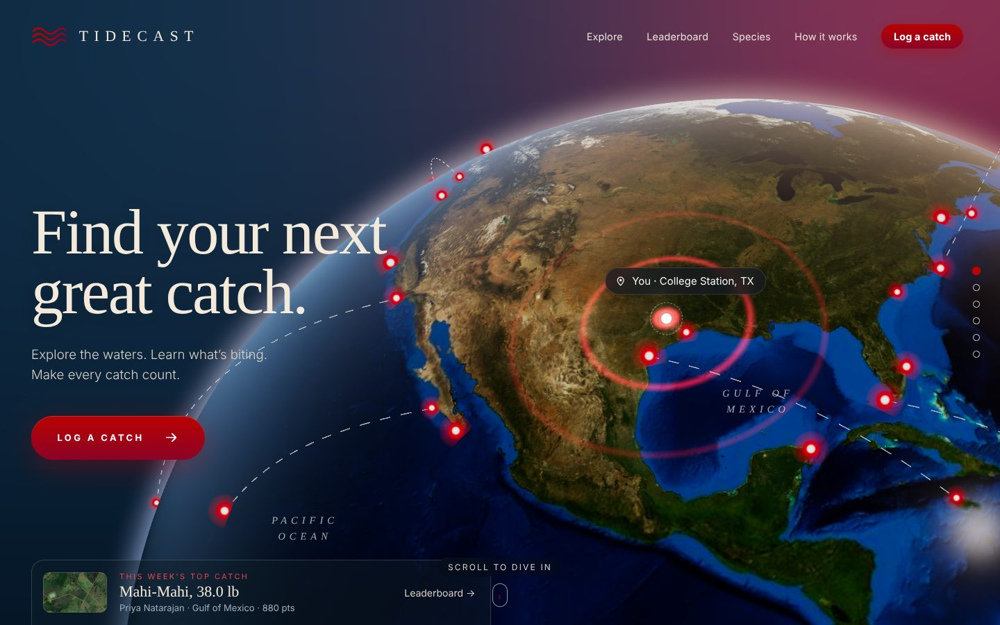
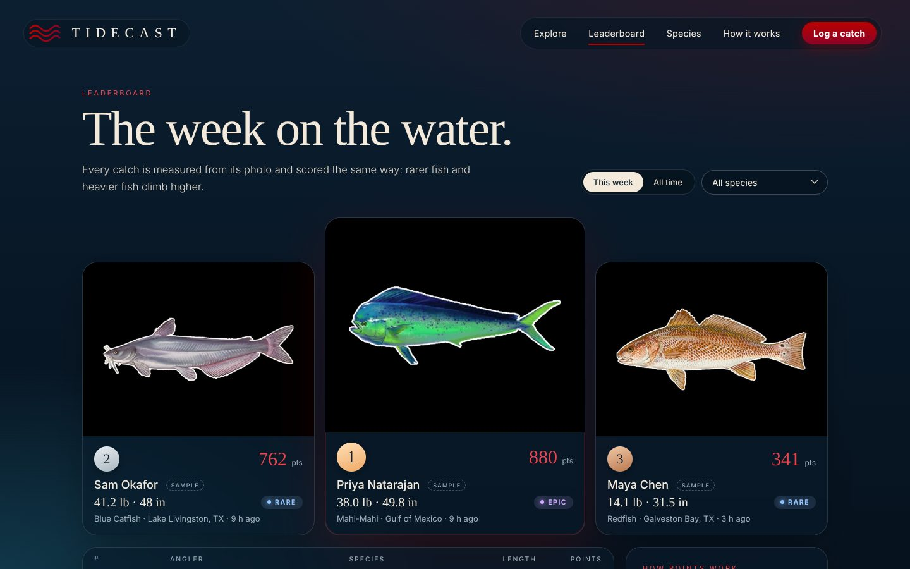
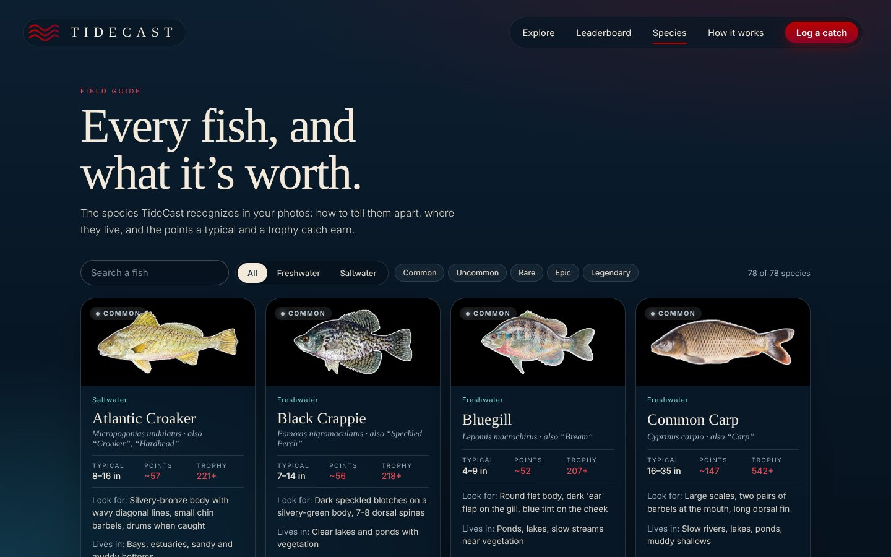
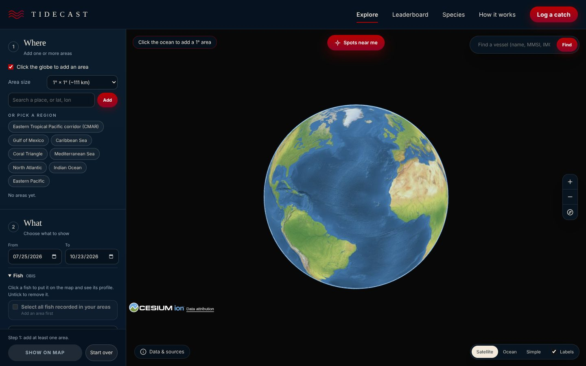
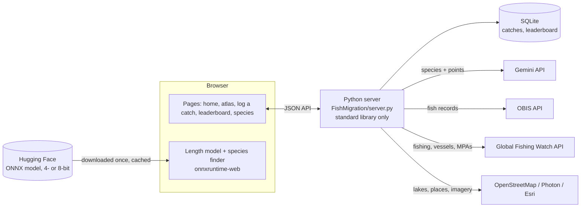

# TideCast

**Find your next great catch.** TideCast is a fishing web app that measures a fish from a single
photo (species, length, weight and points, no scale or tape measure), puts it on a leaderboard,
and lets you explore where fish live and where fishing happens on a 3D globe.

**Live:** [tidecast-kdl9.onrender.com](https://tidecast-kdl9.onrender.com/)
(free hosting: the first visit after a quiet spell takes ~30 s to wake up)

Built in a weekend at **Howdy Hack** by Deveshwar Vankeswaram, Mahish Suresh, Rugved Kamat and Sudhansai.



## What it does

| | |
|---|---|
| **Log a catch** | Upload a photo of your fish. A 1.1-billion-parameter vision model, running **in your browser**, identifies the species and estimates its length; TideCast turns that into weight (with an honest error range) and points. Every result can be corrected before it's posted. |
| **Leaderboard** | This week / all time, filterable by species, with catch photos, rarity and points. |
| **Explore the waters** | A 3D globe of real fish observations ([OBIS](https://obis.org)) and fishing activity, vessels and protected areas ([Global Fishing Watch](https://globalfishingwatch.org)), plus *Spots near me*: the lakes, rivers and bays around you and what to fish for there. |
| **Species guide** | 78 freshwater and saltwater species: how to recognize them, where they live, and what a typical and a trophy catch is worth. |
| **Home** | A scroll-driven 3D journey from orbit down to the water nearest you (three.js + Sentinel-2 satellite imagery). |

| Leaderboard | Species guide | Atlas |
|---|---|---|
|  |  |  |

## How a catch is measured

TideCast has three ways to measure a fish, best first. All three feed the same scoring, and the
server recomputes every number before a catch is posted.

### 1. The learned length model, in the browser

```
photo ─► resize 244 px, centre-crop 224 ─► DINOv2 ViT-g/14 ─► 1,536 features ─┬─► XGBoost (2,147 trees) ─► length (cm)
                                            (ONNX, 4- or 8-bit,               │
                                             onnxruntime-web,                 └─► cosine similarity vs. 316 reference
                                             WebGPU or WebAssembly)                embeddings ─► species (top 3)
```

- **Length.** [DINOv2](https://github.com/facebookresearch/dinov2) turns the photo into 1,536
  image features. A gradient-boosted regressor trained on 2,148 measured fish photos
  ([fishsizeproject/fish-length-predictor](https://github.com/fishsizeproject/fish-length-predictor), MIT)
  maps them to a length. No reference object is needed.
- **Species.** The same features are compared with embeddings of every species' reference photos
  (each also mirrored, so a fish facing either way matches). The closest species is picked and
  the next two are offered as one-tap alternatives.
- **In the browser.** The model is exported to ONNX and its matrix weights quantized
  (`MatMulNBits`, block size 32, `TideCast/ModelService/export_web_model.py`). Visitors pick a size:
  **Standard** (4-bit, 690 MB, lengths within about 1 cm of the full-precision model) or
  **High precision** (8-bit, 1.2 GB, within 0.1 cm). The files are hosted on
  [Hugging Face](https://huggingface.co/Deveshwar123/tidecast-fish-length), downloaded once and kept in
  the browser's Cache Storage. It runs with [onnxruntime-web](https://onnxruntime.ai) on WebGPU when
  available, otherwise multithreaded WebAssembly (the page is cross-origin isolated for that). The
  regressor is a 500 KB binary walked by a few dozen lines of JavaScript, verified against XGBoost to 0.0001 cm.
  So the site needs no GPU server and no API key.

### 2. Gemini + your knuckles

Hold the fish with your knuckles facing the camera. Gemini (via its REST API) names the species and
places six points along the fish's spine plus two knuckle spans. Each span is a ruler: the average
index-to-pinky width is 8.4 cm for men and 7.4 cm for women (5.6 / 4.8 cm for middle-to-pinky), or
your own measurement. The fish's curved length is measured against each ruler and the median is kept.

### 3. By hand

Four taps (snout, tail, two knuckles) and pick the species. This is the fallback when there's no AI.
Every point can be dragged afterwards in any mode.

### From length to points

- **Weight** = *a* · *L*<sup>*b*</sup> with each species' published length–weight constants. The
  range combines the length error with natural variation in how plump fish are.
- **Points** = rarity (Common 50 → Legendary 600) + 10 per pound + 150 for a trophy (longer than
  the species' typical range).
- **Anti-cheat:** lengths past the species' record are rejected, a photo can only be posted once,
  and the browser's numbers are never trusted. The server recomputes from the photo and points.

## Architecture



One small Python server (standard library only, no framework) serves every page and proxies the
outside APIs, so API keys never reach the browser and responses are cached.

## Tech stack

- **Front end:** HTML, CSS and vanilla JavaScript; three.js (home page globe and lake), CesiumJS (atlas), onnxruntime-web (in-browser model)
- **Back end:** Python 3 standard library (`http.server`), SQLite
- **ML:** DINOv2 ViT-g/14, FLAML AutoML / XGBoost, ONNX + 4/8-bit weight quantization, Gemini Flash (vision)
- **Data:** OBIS, Global Fishing Watch API v3, OpenStreetMap (Overpass, Photon), Esri World Imagery, NASA Blue Marble, Copernicus Sentinel-2
- **Hosting:** Render (web server), Hugging Face (model files)

## How we built it

We started Howdy Hack with three separate pieces on three branches:

- a fish-migration atlas (OBIS records on a globe) on `fish-migration`;
- a photo-based weight estimator and leaderboard backend on `weight/leaderboard`;
- a landing page on `Backbone`.

Over the weekend we merged them into one site with one design and one server. We also added
Global Fishing Watch data, the scroll-driven 3D home page and a 78-species field guide with photos.

The hardest part was measuring a fish from a photo. Our first version had Gemini find the fish and
the angler's knuckles, then used the knuckles as a ruler. That works, but only if your hand is in the
shot. We then integrated a learned length model that needs no reference at all. It's a 1.1B-parameter
network, though: too big for a free server, and we didn't want users to install anything. So we
exported it to ONNX, quantized it to 4 or 8 bits (the visitor chooses) and run it in the browser with WebGPU. We reused its image
features for species identification, so one pass through the network gives both the length and the
species.

We used Claude Code as a pair programmer throughout; the commit history shows how the project evolved.

## Run it locally

```bash
git clone https://github.com/Deveshwar123/HowdyHackathon
cd HowdyHackathon/TideCast
python3 FishMigration/server.py        # or double-click start.command on a Mac
```

Python 3 only, nothing to install. It opens http://127.0.0.1:8790/backbone/. Optional keys go in
`TideCast/.env` (never committed):

```
GEMINI_API_KEY=...   # free at aistudio.google.com/apikey: species + point placing
GFW_TOKEN=...        # free at globalfishingwatch.org/our-apis/tokens: fishing-activity layers
```

The in-browser length model works out of the box. To run it on the server instead (faster on a
machine with a GPU): `pip install -r TideCast/ModelService/requirements.txt` and restart.

## Deploy

`render.yaml` deploys the site to Render's free plan (New → Blueprint → this repo). Set
`GEMINI_API_KEY` and `GFW_TOKEN` in the Render dashboard. The model files live on Hugging Face (`TC_WEB_MODEL_BASE`
overrides the location); `TideCast/ModelService/export_web_model.py` rebuilds them, and `TideCast/ModelService/` can also serve
the model as an HTTP API (`MODEL_API_URL`) if you'd rather not run it in the browser.

## Repository layout

```
TideCast/
  Backbone/        the site's pages, design system and in-browser model (tidecast-model.js, model/)
  FishMigration/   the atlas and server.py, the one server for every page and API
  Catch/           catch measuring: Gemini, knuckle math, length model, species finder, scoring, SQLite
  ModelService/    model export for the browser, and an optional model API server
  fish-photos/     source photos and credits for the species pictures
render.yaml        Render deployment
```

Each folder has its own README with details.

## Credits

Fish length model: [fishsizeproject/fish-length-predictor](https://github.com/fishsizeproject/fish-length-predictor) (MIT) ·
DINOv2: Meta AI (Apache 2.0) · Fish records: OBIS · Fishing data: Global Fishing Watch (CC BY-NC 4.0) ·
Maps and places: © OpenStreetMap contributors, Esri World Imagery · Earth textures: NASA Blue Marble ·
Satellite imagery: contains modified Copernicus Sentinel data · Species photos: see `TideCast/fish-photos/CREDITS.md`.
